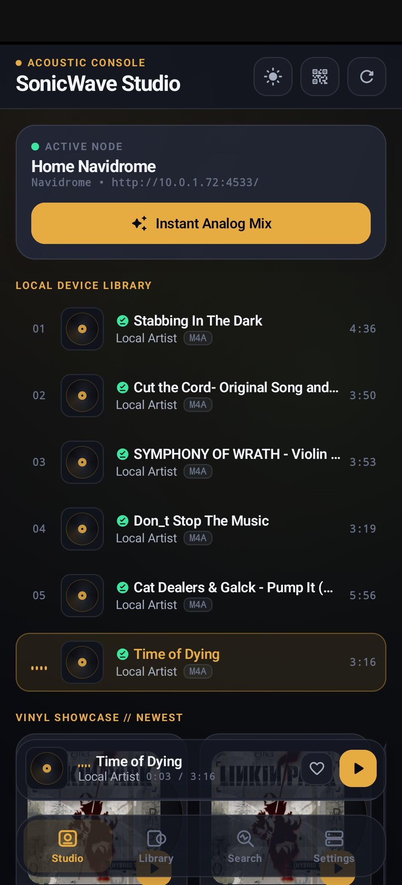
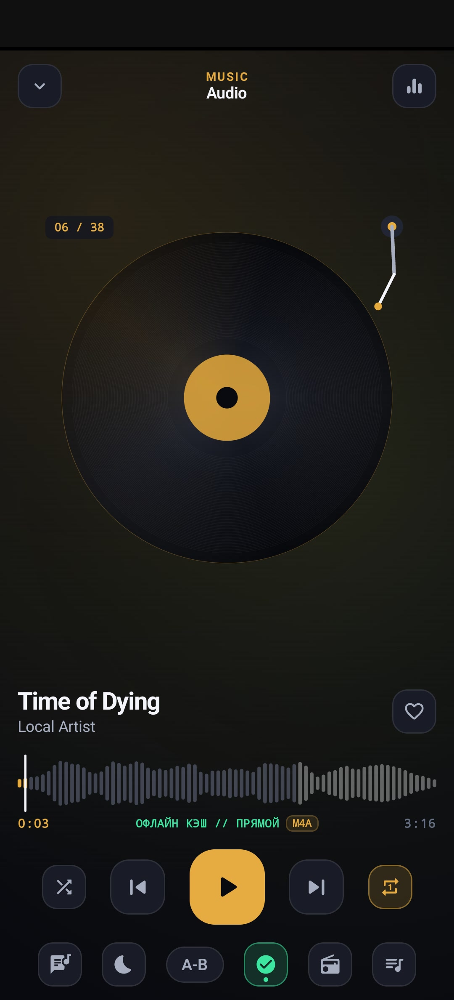
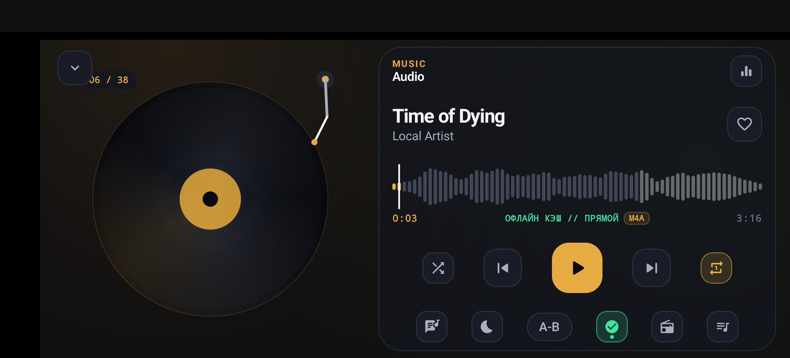
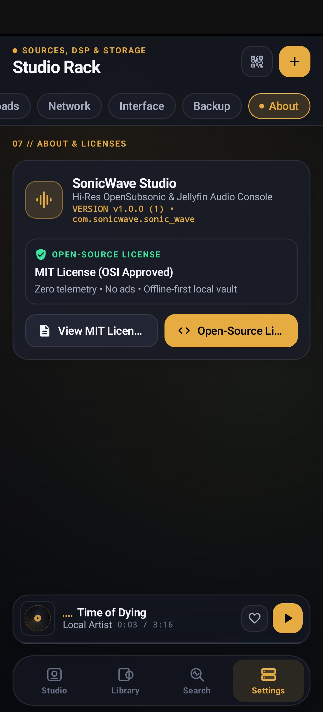

# SonicWave Studio

**SonicWave Studio** is an open-source, privacy-first Hi-Res audio player for **Navidrome**, **OpenSubsonic**, **Jellyfin**, and **local audio folders**, built with Kotlin and Jetpack Compose.

## Features

- **Hi-Res & Lossless Streaming**: Supports FLAC, ALAC, OPUS, M4A, MP3, and configurable Wi-Fi / Mobile transcoding profiles.
- **Offline Vault**: Pinned downloads, automatic smart cache management, and offline playback indicators.
- **Studio DSP Engine**: 10-band graphic equalizer with presets, Bass Boost, Stereo Virtualizer, ReplayGain, playback speed/pitch control, and silence skipping.
- **Vinyl Turntable & Lyrics**: Animated vinyl disc with tonearm, gentle beat-reactive rhythm waves (toggleable in Settings), waveform seekbar with A-B loop, and synchronized `.lrc` lyrics.
- **Dual-Pane Landscape Console**: Dedicated landscape layout with a side navigation rail and split turntable + studio control console.
- **Multi-Server & Privacy-First**: Manage multiple server nodes with LAN/WAN fallback, TOFU self-signed SSL pinning, QR configuration sharing, zero telemetry, and no ads.

## Screenshots

| Studio Console | Portrait Player | Landscape Studio | About & Licenses |
| :---: | :---: | :---: | :---: |
|  |  |  |  |

## Tech Stack

- **UI**: Jetpack Compose, Material 3, custom Canvas painters (`VinylGrooveDisc`, `WaveformSeekBar`)
- **Audio**: AndroidX Media3 (`ExoPlayer`, `MediaLibraryService`, Android Auto support)
- **Persistence**: Room SQLite, EncryptedSharedPreferences (`security-crypto`)
- **Networking & Media**: OkHttp, Coil, Gson, AndroidX Palette

## Building from Source

```bash
gradle assembleRelease
```

## License

This project is licensed under the **MIT License** — see the [LICENSE](LICENSE) file for details.
